# 🚀 Awesome Customer Community & Forum Software

<p align="center">
  
</p>

<p align="center">
  <a href="https://github.com/ishandutta2007/Awesome-Awesome-Awesome"></a>
  <a href="https://discord.gg/jc4xtF58Ve"></a>
  <a href="https://github.com/ishandutta2007/Awesome-Customer-Community-Forum-Software/stargazers"></a>
  <a href="https://github.com/ishandutta2007/Awesome-Customer-Community-Forum-Software/network/members"></a>
  <a href="https://github.com/ishandutta2007/Awesome-Customer-Community-Forum-Software/blob/main/LICENSE"></a>
  <a href="https://github.com/ishandutta2007"></a>
</p>

---

> 🌟 **A curated index of top-tier open-source customer community platforms, self-hosted forum engines, bulletin boards, Q&A support portals, and SaaS customer engagement hubs.**

Whether you are building a developer support hub, an enterprise knowledge base, a creator membership network, or a self-hosted community forum, this directory compares production-ready open-source platforms and leading hosted SaaS solutions by feature depth, architecture, pricing transparency, and scale.

---

## 📑 Table of Contents

- [📊 Sector Overview & Market Dynamics](#-sector-overview--market-dynamics)
- [🏢 SaaS/Hosted Platforms](#-saashosted-platforms)
- [💻 Open-Source GitHub Projects](#-open-source-github-projects)
  - [Top Open-Source Community & Forum Platforms (Sorted by Stars)](#top-open-source-community--forum-platforms-sorted-by-stars)
- [🛠️ Architectural & Platform Selection Guide](#️-architectural--platform-selection-guide)
- [🤝 How to Contribute](#-how-to-contribute)
- [💖 Support & Sponsorship](#-support--sponsorship)
- [📈 Star History](#-star-history)
- [⚠️ Disclaimer](#️-disclaimer)

---

## 📊 Sector Overview & Market Dynamics

The global customer community and forum software market is estimated at **$1.8B to $2.4B** (scaling toward **$6.0B+** at ~11–13% CAGR), driven by enterprise support deflection, community-led growth (CLG), and customer retention strategies. The market is **moderately fragmented** rather than winner-take-all: enterprise CRM suites and private equity-backed platforms (e.g., Khoros, Higher Logic) coexist alongside fast-growing self-serve creator/community hubs (Circle, Mighty Networks) and mature, self-hosted open-source standards.

---

## 🏢 SaaS/Hosted Platforms

| Platform | Revenue / Valuation (Company Size) | Pricing (Starting Tier) | Free Tier / Trial Limits | Description & Target Audience |
| :--- | :--- | :--- | :--- | :--- |
| **[Khoros](https://khoros.com/)** | **~$250M ARR** (Acquired by IgniteTech; $125M+ raised) | Starts at **$50,000/year** (median enterprise contract **$164,649/year**; custom enterprise quotes) | **No open self-serve trial** (sales-led pilot/proof-of-concept provisioned on contract approval) | Enterprise customer engagement & social care suite. Built for global brands needing advanced moderation, CRM workflows, and support deflection. |
| **[Higher Logic Vanilla](https://www.higherlogic.com/)** | **~$50M–$70M ARR** ($55M PE round from JMI Equity) | Starts at **$24,000/year** ($2,000/month equivalent, billed annually) | **No standard self-serve trial** (sales-guided sandbox/demo environment after consultation) | Enterprise-grade cloud community forum and knowledge hub with heavy CRM/AMS integrations and enterprise permissions. |
| **[Hivebrite](https://hivebrite.io/)** | **~$21M ARR** ($58.9M total funding; $37M Series B) | Starts at **$8,000/year** (Focus Plan; billed annually) | **No self-serve free trial** (sales-led product demo and custom-scoped evaluation instance) | White-label community management platform tailored for alumni networks, professional associations, and corporate membership hubs. |
| **[Circle](https://circle.so/)** | **$200M–$250M Valuation** ($30M+ funding; profitable) | Starts at **$89/month** (billed annually) or **$99/month** (monthly billing, Professional Plan) | **14-day free trial** (full access to core Professional/Business features, no credit card required) | All-in-one community and digital business platform integrating discussions, courses, live events, paywalls, and member chat. |
| **[Mighty Networks](https://www.mightynetworks.com/)** | **$200M Valuation** (~$67M funding; ~$10M–$35M ARR) | Starts at **$79/month** (billed annually, Launch Plan; or $179/month for Scale Plan) | **14-day free trial** (full access to Growth Plan features including live streaming & courses, no credit card required) | Community platform for creator businesses and networks featuring rich multimedia feeds, online courses, and event livestreaming. |
| **[Bettermode](https://bettermode.com/)** | **~$3.1M ARR** ($7.5M Seed funding) | Starts at **$149/month** (billed annually) or **$199/month** (monthly billing, Starter Plan) | **Free tier available**: up to **100 members, 20 spaces, 3 collaborators, 1 GB storage, 1,000 email credits/mo** (with Bettermode branding) | Modular, customizable customer community platform with embeddable widgets, knowledge base, discussions, and idea exchanges. |

> [!NOTE]
> **HubSpot Community** is HubSpot's proprietary customer community forum rather than a commercial software product sold to external customers, and is therefore omitted from evaluable SaaS vendor comparisons.

---

## 💻 Open-Source GitHub Projects

The open-source community forum landscape is exceptionally mature. Projects range from battle-tested bulletin boards and real-time discussion engines to federated social spaces and developer Q&A portals. Below are the leading open-source options, ranked by GitHub stars.

### Top Open-Source Community & Forum Platforms (Sorted by Stars)

- **[Discourse](https://github.com/discourse/discourse)** [](https://github.com/discourse/discourse/stargazers) `GPL-2.0`  
  **The industry standard for self-hosted community forums** — battle-tested by Docker, Figma, Mozilla, Rust, and the BBC.  
  - **Features**: Trust-level gamification system, built-in chat alongside threaded topics, granular moderation queues, rich markdown/text editor, Akismet anti-spam, incoming email replies, and 200+ modular plugins.  
  - **Tech Stack**: Ruby on Rails, PostgreSQL, Redis, Sidekiq, Ember.js.  
  - **Deployment**: Official Docker launcher (`discourse-setup`) or Discourse Cloud.  
  - **Trade-off**: Requires dedicated server resources (2 GB RAM minimum, 4 GB recommended); mandatory working SMTP server.  
  - **Best for**: Established companies, open-source projects, and developer communities requiring enterprise moderation, SSO (SAML/OIDC), and rock-solid SEO.

- **[Forem](https://github.com/forem/forem)** [](https://github.com/forem/forem/stargazers) `AGPL-3.0`  
  **Open-source software powering inclusive, creator-led communities** — original codebase backing the DEV Community (`dev.to`).  
  - **Features**: Rich article publishing, threaded discussions, podcast/video hosting, customizable tags, badges, and built-in community moderation tools.  
  - **Tech Stack**: Ruby on Rails, PostgreSQL, Redis, Elasticsearch, Preact.  
  - **Deployment**: Docker, Self-hosted Linux VM, or Forem Cloud.  
  - **Trade-off**: Heavy infrastructure footprint geared toward publishing/content ecosystems rather than concise Q&A ticket resolution.  
  - **Best for**: Content-driven developer communities, technical media publications, and multi-author blogging platforms.

- **[Flarum](https://github.com/flarum/flarum)** [](https://github.com/flarum/flarum/stargazers) `MIT`  
  **Delightfully modern, lightweight forum software** — fast, responsive, and designed for speed with minimal overhead.  
  - **Features**: Infinite scrolling, floating composer, real-time notifications, mobile gestures, and an ultra-extensible "everything is an extension" plugin architecture.  
  - **Tech Stack**: PHP (Laravel components), Mithril.js, MySQL / MariaDB.  
  - **Deployment**: Lightweight Docker Compose or standard LAMP/LEMP shared hosting (runs comfortably on 512 MB RAM).  
  - **Trade-off**: Single-level threading without deep reply nests; smaller extension ecosystem than Discourse; no native out-of-the-box chat without third-party extensions.  
  - **Best for**: Small-to-medium communities (under 5,000 DAU) seeking an elegant, lightning-fast forum on budget-friendly hosting.

- **[Apache Answer](https://github.com/apache/answer)** [](https://github.com/apache/answer/stargazers) `Apache-2.0`  
  **Open-source Q&A community and knowledge-base software** — built under the Apache Software Foundation for technical Q&A hubs.  
  - **Features**: StackOverflow-style question-and-answer workflows, upvoting/downvoting, reputation score system, answer acceptance, badges, SEO optimization, and multilingual support.  
  - **Tech Stack**: Go (Golang), React, SQLite/MySQL/PostgreSQL.  
  - **Deployment**: Docker, Docker Compose, or standalone compiled binary.  
  - **Trade-off**: Focused strictly on Q&A and knowledge sharing; lacks traditional open-ended threaded discussions or real-time social feeds.  
  - **Best for**: Developer support portals, internal engineering knowledge bases, and customer product troubleshooting forums.

- **[NodeBB](https://github.com/NodeBB/NodeBB)** [](https://github.com/NodeBB/NodeBB/stargazers) `GPL-3.0`  
  **Real-time Node.js forum platform built for the modern web** — WebSocket-first architecture delivering instantaneous updates without page refreshes.  
  - **Features**: Instant live notifications, streaming post updates, user presence ("who's online"), built-in direct messaging, karma/reputation system, and REST/WebSocket APIs for custom app embedding.  
  - **Tech Stack**: Node.js, MongoDB (or PostgreSQL/Redis), WebSockets.  
  - **Deployment**: Docker Compose, Kubernetes, or self-hosted Linux node.  
  - **Trade-off**: MongoDB operational overhead; default themes require customization to feel distinct; real-time sync can demand tuning under high-latency mobile networks.  
  - **Best for**: Gaming communities, live developer discussions, and tech products wanting real-time interaction on a pure JavaScript/TypeScript stack.

- **[Lemmy](https://github.com/LemmyNet/lemmy)** [](https://github.com/LemmyNet/lemmy/stargazers) `AGPL-3.0`  
  **Federated link aggregator and discussion platform for the Fediverse** — decentralized alternative to Reddit powered by ActivityPub.  
  - **Features**: Cross-server federation via ActivityPub, community sub-forums, voting, nested comments, cross-posting, and mobile client support (Voyager, Boost, Sync).  
  - **Tech Stack**: Rust, Actix-web, PostgreSQL, Inferno.  
  - **Deployment**: Docker Compose, Kubernetes.  
  - **Trade-off**: Federation architecture is complex to administer; designed for public decentralized networks rather than private, brand-locked customer communities.  
  - **Best for**: Decentralized open-web networks, privacy-conscious interest groups, and communities resistant to single-platform ownership.

- **[HumHub](https://github.com/humhub/humhub)** [](https://github.com/humhub/humhub/stargazers) `AGPL-3.0`  
  **Flexible open-source social network kit and intranet software** — tailored for corporate communities, alumni hubs, and collaborative spaces.  
  - **Features**: Activity streams, custom spaces, member directories, file sharing, calendar integration, polls, wikis, and enterprise LDAP/SAML integration.  
  - **Tech Stack**: PHP (Yii 2 framework), MySQL / MariaDB, Vue.js.  
  - **Deployment**: Docker Compose or standard web servers (Apache/Nginx).  
  - **Trade-off**: Structured more like Facebook Groups or Yammer than a technical forum or linear support bulletin board.  
  - **Best for**: Educational institutions, corporate intranets, nonprofit alumni networks, and collaborative team workspaces.

- **[phpBB](https://github.com/phpbb/phpbb)** [](https://github.com/phpbb/phpbb/stargazers) `GPL-2.0`  
  **The legendary grandfather of bulletin boards** — reliable, hyper-stable flat-file forum engine with over two decades of production deployment.  
  - **Features**: Deep category and subforum hierarchies, fine-grained ACL permissions, attachment managers, extensive bbCode formatting, and thousands of community styles/modifications.  
  - **Tech Stack**: PHP, MySQL / MariaDB / PostgreSQL / SQLite.  
  - **Deployment**: Any standard PHP/MySQL hosting environment with zero container overhead.  
  - **Trade-off**: Traditional 2000s forum UX requiring full page refreshes; lacks modern real-time interactions and mobile-first gestures without heavy modding.  
  - **Best for**: Classic hobbyist boards, retro enthusiasts, and low-spec shared hosting environments where rock-solid reliability is paramount.

- **[Coral Talk](https://github.com/coralproject/talk)** [](https://github.com/coralproject/talk/stargazers) `Apache-2.0`  
  **Open-source journalism commenting and community moderation platform** — created by Vox Media and used by newsrooms worldwide.  
  - **Features**: Real-time comment streams, smart automated moderation (Perspective API integration), toxic comment filters, badge verification, and journalist Q&A mode.  
  - **Tech Stack**: TypeScript, Node.js, GraphQL, MongoDB, Redis.  
  - **Deployment**: Docker Compose, Kubernetes, or managed cloud instances.  
  - **Trade-off**: Designed as an embedded commenting widget on articles and blogs rather than a standalone standalone multi-category forum.  
  - **Best for**: News organizations, media publications, and editorial platforms looking for high-trust user discussions.

- **[Talkyard](https://github.com/debiki/talkyard)** [](https://github.com/debiki/talkyard/stargazers) `AGPL-3.0`  
  **Unified discussion software combining Slack, StackOverflow, Discourse, and Reddit** — all-in-one community conversation hub.  
  - **Features**: Question-and-answer topics with solution verification, nested discussions, embedded blog commenting, team chat rooms, and spam protection.  
  - **Tech Stack**: Scala, React, PostgreSQL, Redis, OpenResty.  
  - **Deployment**: Docker Compose or Talkyard Managed Hosting.  
  - **Trade-off**: Scala backend requires familiarity; smaller developer contributor base compared to mainstream Node or Ruby ecosystems.  
  - **Best for**: Companies seeking a single platform that handles both Q&A support and casual conversational chat without tool fragmentation.

- **[MyBB](https://github.com/mybb/mybb)** [](https://github.com/mybb/mybb/stargazers) `LGPL-3.0`  
  **Free, intuitive, and extensible open-source bulletin board package** — modern evolution of traditional forum architecture.  
  - **Features**: Inline moderation, private messaging, reputation and warning systems, custom profile fields, thread subscriptions, and plugin hook system.  
  - **Tech Stack**: PHP, MySQL / PostgreSQL / SQLite.  
  - **Deployment**: Standard shared hosting or dedicated LAMP stack.  
  - **Trade-off**: Traditional server-rendered architecture; requires manual maintenance of plugins during core version upgrades.  
  - **Best for**: Classic community forums seeking an approachable administration control panel and minimal server operating costs.

---

## 🛠️ Architectural & Platform Selection Guide

```
                            Community Requirement
                                     │
           ┌─────────────────────────┴─────────────────────────┐
           ▼                                                   ▼
 💻 Self-Hosted / Data Sovereignty                     ☁️ Fully Managed SaaS
           │                                                   │
   ┌───────┴───────┐                                   ┌───────┴───────┐
   ▼               ▼                                   ▼               ▼
Support / Q&A   Threaded Forum                  Creator / Network   Enterprise CRM
   │               │                                   │               │
Apache Answer   Discourse (Ruby/Postgres)           Circle          Khoros
Talkyard        Flarum (PHP/MySQL)                  Mighty Net.     Higher Logic
                NodeBB (Node/Mongo)                 Bettermode      Hivebrite
```

- **For Large Enterprise Customer Support**: Choose **Discourse** (if self-hosted) or **Khoros / Higher Logic** (if enterprise SaaS) for fine-grained permissions, automated ticket deflection, and SSO integration.
- **For Fast Lightweight Hosting**: Choose **Flarum** (PHP-based, under 512MB RAM) for high speed and clean mobile UX.
- **For Real-Time Collaboration & Chat**: Choose **NodeBB** (WebSocket-first) for immediate messaging and live event interactions.
- **For Knowledge Bases & Technical Help Desks**: Choose **Apache Answer** for StackOverflow-style Q&A workflows.
- **For Creator Monetization & Courses**: Choose **Circle** or **Mighty Networks** for native paywalls, course modules, and community events.

---

## 🤝 How to Contribute

Contributions are welcome! Please follow these guidelines:

1. 🍴 Fork this repository.
2. 🌿 Create a new branch: `git checkout -b feature/add-new-platform`.
3. 📝 Add your entry under the appropriate section following the existing markdown schema. Ensure links, license information, tech stack, and GitHub star badges are accurate.
4. 🚀 Submit a Pull Request with a concise summary of the addition.

---

## 💖 Support & Sponsorship

If this curated catalog helps you discover, evaluate, or architect your community forum platform, please consider showing your support:

- 🌟 **Star this repository** to help others discover it.
- 🍴 **Fork and share** with fellow community managers, developers, and DevOps engineers.
- ☕ **Sponsor the Maintainer**: Support ongoing curation and open-source tooling on GitHub Sponsors:  
  [](https://github.com/sponsors/ishandutta2007)

---

## 📈 Star History

[](https://star-history.dera.page/#ishandutta2007/Awesome-Customer-Community-Forum-Software&type=date&legend=top-left)

---

## ⚠️ Disclaimer

- This catalog is community-curated for informational and architectural evaluation purposes. Inclusion does not imply official endorsement.
- All community platforms handling user personal identifiable information (PII) must comply with applicable data protection regulations (GDPR, CCPA, etc.). Ensure your infrastructure and data retention policies meet your organization's legal standards before deploying to production.
